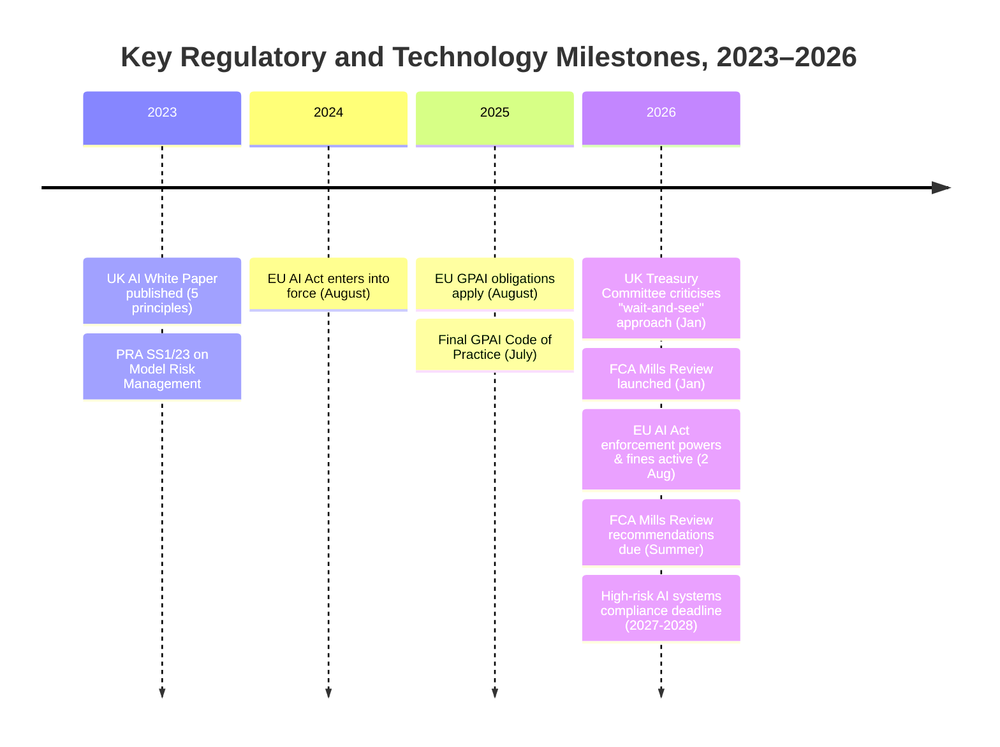

---

topic: 'The trajectory of AI regulation across the EU AI Act, the UK''s pro-innovation and contextual approach, and the financial-services regulatory regime (FCA, PRA, Bank of England) from January 2023 to May 2026, including the FCA Mills Review, GPAI obligations, model-risk and accountability rules, and what they demand of technology leadership in regulated firms'
date: 2026-05-19
from: 2023
to: 2026
lanes: [financial, frontier, academic, vc, blogs, tech]
depth: deep
brief_title: 'AI Regulation and the Regulated Enterprise — Trajectory to 2030'
---
### Overview

Between early 2023 and mid-2026, the regulatory landscape for artificial intelligence in financial services crystallised around a fundamental divergence. The European Union committed to a comprehensive, prescriptive, and horizontal legal framework with the AI Act, while the United Kingdom championed a pro-innovation, principles-based, and sectoral approach. This split creates significant strategic and compliance challenges for financial firms operating across both jurisdictions, forcing them to navigate two increasingly distinct regimes for governance, risk management, and accountability.

This period was defined by the EU moving from political agreement to practical implementation. By August 2025, obligations for General-Purpose AI (GPAI) models were live, with the prospect of severe fines from August 2026 focusing minds on compliance. The final GPAI Code of Practice, published in July 2025, translated abstract principles on transparency and risk into concrete, albeit challenging, technical requirements for model providers. The Act’s extraterritorial reach ensures that any firm placing a high-risk AI system on the EU market, regardless of its own location, is bound by these rules.

In contrast, the UK’s approach faced growing scrutiny. While regulators like the Financial Conduct Authority (FCA) and Prudential Regulation Authority (PRA) maintained that existing, technology-neutral frameworks were sufficient, this position was sharply criticised. A January 2026 Treasury Committee report labelled the stance a "wait-and-see" approach that risked consumer harm and financial instability. The subsequent launch of the FCA’s Mills Review into the long-term impact of AI signals a potential, though not guaranteed, shift in regulatory thinking, with its recommendations in summer 2026 poised to be a critical inflection point.

This regulatory divergence is unfolding against a backdrop of exponentially accelerating AI capability. Frontier labs like [MODEL-PROVIDER], [MODEL-PROVIDER], and [MODEL-PROVIDER] released a rapid succession of powerful models, including [MODEL-PROVIDER]-5, [MODEL-PROVIDER] 4, and [MODEL-PROVIDER] 3. These systems demonstrated increasingly autonomous and agentic behaviours, pushing the boundaries of what existing risk and accountability frameworks were designed to manage. For technology leaders in regulated firms, the central challenge is to build a defensible AI operating model that can satisfy both the EU’s prescriptive demands and the UK’s contextual expectations, all while the underlying technology continues to evolve at a blistering pace.

### Key Findings

**The EU AI Act is now a hard compliance reality**
By mid-2026, the EU AI Act has moved from legislative text to operational reality. Obligations for providers of GPAI models, covering transparency, technical documentation, and compliance with EU copyright law, have been applicable since August 2025. The critical deadline of 2 August 2026 looms, when the European Commission’s enforcement powers and the threat of significant fines, up to 3% of global turnover or €15 million, become active. A May 2026 "AI omnibus" package extended transition periods for some high-risk systems into 2027 and 2028, but this signals a recognition of implementation complexity rather than a softening of regulatory intent.
Sources: ; ; 

**The UK’s principles-based stance is under sustained pressure**
The UK government’s 2023 White Paper established five cross-sector principles: safety, security and robustness; transparency and explainability; fairness; accountability and governance; and contestability and redress. Financial regulators have insisted these can be managed through existing rules. However, a January 2026 report from the House of Commons Treasury Committee sharply criticised this "wait-and-see" attitude, demanding regulators provide clearer guidance, conduct AI-specific stress tests, and designate major AI and cloud providers as critical third parties. This political pressure suggests the current light-touch approach may not be sustainable.
Sources: ; ; 

**Existing financial rules are the de facto AI regulation in the UK**
In the absence of new AI-specific legislation, UK regulators are explicitly applying established frameworks to AI systems. These include the PRA’s Supervisory Statement 1/23 on model risk management, which sets expectations for model governance across its lifecycle. The FCA’s Consumer Duty requires firms to demonstrate they are delivering good outcomes and fair value, a principle that directly governs AI used in pricing or advice. The Senior Managers and Certification Regime (SMCR) creates individual accountability for the outcomes of AI systems, while operational resilience rules, aligned with the EU’s DORA, address third-party risk from model and cloud providers.
Sources: [[sources-the-trajectory-of-ai-regulation-across-the-eu-ai-a#^v11|Aveni (2026)]] ([↗]()); ; 

**The FCA Mills Review will define the UK’s next move**
Launched in January 2026, the FCA’s Mills Review is the most significant forward-looking regulatory initiative in the UK. Its scope is broad, examining the long-term impact of AI on retail financial services, including the challenges posed by autonomous and agentic systems, the potential for new market structures to emerge, and how the regulator itself must evolve by 2030. With recommendations due to the FCA Board in summer 2026, its findings will likely determine whether the UK maintains its sectoral approach or moves towards a statutory AI Bill.
Sources: ; 

**Agentic AI capabilities are outpacing regulatory frameworks**
The period saw an explosion in AI capabilities, particularly towards autonomous task completion. The release of models like [MODEL-PROVIDER]'s [MODEL-PROVIDER] 4 in May 2025 and Google's [MODEL-PROVIDER] Deep Think in February 2026 demonstrated advanced reasoning and problem-solving. Independent evaluations by METR, using benchmarks like HCAST and an updated methodology released in January 2026, confirmed an accelerated rate of progress. This rapid advance towards agentic systems, which can act independently, creates profound challenges for regulatory frameworks built on assumptions of direct human oversight and control.
Sources: [[sources-the-trajectory-of-ai-regulation-across-the-eu-ai-a#^t20|METR (2026)]] ([↗]()); [[sources-the-trajectory-of-ai-regulation-across-the-eu-ai-a#^t13|IntuitionLabs (2025)]] ([↗]()); [[sources-the-trajectory-of-ai-regulation-across-the-eu-ai-a#^t21|[MODEL-PROVIDER] (2026)]] ([↗]()); 

**Accountability across the value chain is a critical gap**
Both regulatory regimes are grappling with how to assign responsibility for AI-driven outcomes across a complex value chain, from foundational model developers to deployers. Academic analysis of the EU AI Act points to potential accountability deficits, especially for autonomous agents used in critical infrastructure. In the UK, while SMCR provides a framework for individual accountability within firms, the Treasury Committee has called for clearer guidance on how it applies to complex AI systems, particularly those reliant on third-party models.
Sources: [[sources-the-trajectory-of-ai-regulation-across-the-eu-ai-a#^a5|Journal of European Competition Law & Practice (2026)]] ([↗]()); ; 

**Robust governance is now a competitive advantage**
Despite regulatory uncertainty, financial firms are investing heavily in AI. However, analyst reports indicate a shift in thinking, where compliance and risk management are no longer seen as mere costs but as enablers of scalable, defensible AI adoption. McKinsey research highlights the need for Chief Risk Officers to lead the development of clear governance frameworks. CB Insights notes that robust compliance is becoming a competitive differentiator, allowing firms to deploy AI with greater confidence and trust.
Sources: [[sources-the-trajectory-of-ai-regulation-across-the-eu-ai-a#^v2|McKinsey & Company (2026)]] ([↗]()); [[sources-the-trajectory-of-ai-regulation-across-the-eu-ai-a#^v8|CB Insights (2026)]] ([↗]()); [[sources-the-trajectory-of-ai-regulation-across-the-eu-ai-a#^v10|Hogan Lovells (2026)]] ([↗]())

### Evidence & Data

Adoption and investment in AI within financial services have accelerated dramatically, even as regulatory frameworks solidify. A 2026 report from the Cambridge Centre for Alternative Finance found that 81% of financial services firms globally are now adopting AI in some form. However, maturity varies widely, with only 14% of firms considered advanced in their implementation, a group in which fintechs are over-represented compared to incumbents.
Sources: [[sources-the-trajectory-of-ai-regulation-across-the-eu-ai-a#^v9|Cambridge Centre for Alternative Finance (CCAF) (2026)]] ([↗]())

This adoption is backed by significant financial commitment. According to a late 2025 survey by Bain & Company, 83% of Chief Financial Officers planned to increase their enterprise-wide AI spending by over 15% in the following two years. A more recent Bain study from April 2026 found that 42% of CFOs intended to boost AI investment by more than 30%. Gartner predicts this trend will culminate in the emergence of an "AI-First Finance Function" by 2026.
Sources: [[sources-the-trajectory-of-ai-regulation-across-the-eu-ai-a#^v4|Bain & Company (2025)]] ([↗]()); [[sources-the-trajectory-of-ai-regulation-across-the-eu-ai-a#^v5|Bain & Company (2026)]] ([↗]()); [[sources-the-trajectory-of-ai-regulation-across-the-eu-ai-a#^v7|Gartner (2025)]] ([↗]())

The regulatory deadlines provide a clear timeline for compliance activity. Under the EU AI Act, GPAI model obligations took effect in August 2025. The key enforcement date is 2 August 2026, when penalties of up to 3% of global annual turnover become applicable for non-compliance. For designated high-risk systems, such as those used in credit scoring, the full set of obligations will become enforceable in 2027, following an extension granted by the May 2026 "AI omnibus" package.
Sources: ; 

Meanwhile, the pace of underlying technological progress shows no signs of slowing. In January 2026, the independent evaluation group METR released its Time Horizon 1.1 methodology, which concluded that the rate of progress in AI autonomous capabilities had accelerated since 2023. This empirical finding underscores the challenge for regulators trying to create durable rules for a technology that is a rapidly moving target.
Sources: [[sources-the-trajectory-of-ai-regulation-across-the-eu-ai-a#^t20|METR (2026)]] ([↗]())

### Signals & Tensions

**Prescriptive Certainty vs. Contextual Flexibility**
The core tension is the philosophical divide between the EU and UK. The EU AI Act provides legal certainty through detailed, prescriptive rules, but risks becoming quickly outdated or stifling innovation. The UK’s contextual, principles-based approach is more agile but creates ambiguity for firms, which must interpret how vague principles apply to complex new technologies. The Treasury Committee’s intervention suggests patience with this ambiguity is wearing thin.
Sources: [[sources-the-trajectory-of-ai-regulation-across-the-eu-ai-a#^a6|FRANKI T (2026)]] ([↗]()); 

**Technology-Neutrality Under Strain**
UK financial regulators have long favoured technology-neutral rules that focus on outcomes rather than specific systems. This approach is being severely tested by generative and agentic AI, which exhibit emergent properties and failure modes fundamentally different from earlier technologies. The debate is whether concepts like model risk management, designed for statistical models, can be stretched to cover foundation models, or if AI-specific rules are now unavoidable.
Sources: ; 

**The Inevitability of a UK AI Bill**
While the government and regulators have so far resisted a dedicated UK AI Act, political and practical pressures are mounting. The complexity of governing GPAI, the need for legal clarity to attract investment, and the risk of regulatory divergence with the EU all point towards the eventual necessity of a statutory framework. The Mills Review is a key signal; if it highlights significant gaps in the existing regime, momentum for a general AI Bill in the next parliamentary session will likely become unstoppable.
Sources: 

**Concentration Risk from Unregulated Tech Giants**
A growing, under-reported tension is the financial system's increasing reliance on a small number of large, unregulated technology firms for both cloud infrastructure and frontier AI models. This creates a significant concentration of systemic risk outside the traditional regulatory perimeter. While the Treasury Committee has called for these firms to be designated as "critical third parties," the mechanism and appetite for direct supervision of Big Tech by financial regulators remains a contentious and unresolved issue.
Sources: ; [[sources-the-trajectory-of-ai-regulation-across-the-eu-ai-a#^v12|International Regulatory Strategy Group (IRSG) (2026)]] ([↗]())

### Open Questions

*   **Practicality of GPAI Compliance:** How will major model providers technically and operationally meet the EU AI Act’s transparency requirements, such as summarising copyrighted training data? Academic research suggests this may require fundamental architectural changes, not just documentation.
*   **Impact of the Mills Review:** What will the FCA’s Mills Review recommend in summer 2026? Will it propose a fundamental shift in the UK’s approach, or will it endorse the current sectoral model with minor adjustments? The outcome will set the course for UK financial AI regulation for the rest of the decade.
*   **Effectiveness of SMCR for AI:** Can a regime designed for human decision-making, like the UK’s SMCR, effectively assign accountability for harms caused by opaque, autonomous AI systems, especially when those systems are sourced from third-party vendors?
*   **Global Regulatory Fragmentation:** Will the divergence between the EU’s prescriptive model and the UK’s contextual approach lead to a fragmented global market for AI in finance, increasing compliance costs and creating opportunities for regulatory arbitrage?
*   **Supervision of Critical AI Providers:** How, and when, will regulators in the UK and EU establish effective oversight of the handful of non-financial technology companies that provide the foundational models and cloud infrastructure upon which the financial system increasingly depends?
*   **Gaps in Existing Frameworks:** Where are the genuine gaps between principles-based rules and the behaviour of agentic AI? Can existing frameworks for consumer protection, model risk, and operational resilience adequately address novel risks like emergent deception or autonomous collusion?

---